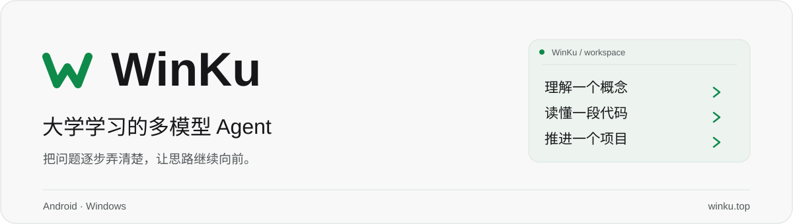

<p align="center">
  <a href="https://winku.top/">
    <picture>
      <source media="(prefers-color-scheme: dark)" srcset="docs/assets/readme/winku-header-dark.svg">
      <source media="(prefers-color-scheme: light)" srcset="docs/assets/readme/winku-header-light.svg">
      
    </picture>
  </a>
</p>

<p align="center">
  在手机和电脑上，用自己的模型，把课程问题、编程思路和竞赛准备逐步弄清楚。
</p>

<p align="center">
  <a href="https://winku.top/"></a>
  <a href="https://github.com/Excapesx/WinKu/releases"></a>
  <a href="#下载与安装"></a>
  <a href="LICENSE"></a>
</p>

<p align="center">
  <a href="https://winku.top/"><b>官方网站</b></a> ·
  <a href="#下载与安装"><b>下载客户端</b></a> ·
  <a href="#快速开始">开始使用</a> ·
  <a href="https://github.com/Excapesx/WinKu/issues">反馈问题</a> ·
  <a href="#来源声明">开源与致谢</a>
</p>

---

## 关于 WinKu

WinKu 是面向大学学习、编程与项目实践的多模型 AI Agent 客户端。Android 与 Windows 内置 dsh 引擎，将模型对话、学习内容渲染和设备工具放在同一个工作空间中；你可以连接自己的模型服务，并按任务使用 Skills 与 MCP 扩展。

| 学习与理解 | 编程与实践 | 模型与工具 |
|---|---|---|
| 公式、代码、图表与交互测验，让讲解更容易跟上 | 结合代码与文件材料分析问题，辅助课程项目和竞赛准备 | 支持 Chat Completions、Responses 与 Anthropic Messages，按需连接扩展并授权工具 |

> **当前为 v1.0.1 测试版。** 首次使用需要配置模型服务与 API Key，模型费用与额度由服务商决定。Android 和 Windows 分别保存本机的会话与配置，暂不支持云端同步。
>
> **开源来源：** Android 端衍生自 [jackwener/DSH-Android](https://github.com/jackwener/DSH-Android)（Apache-2.0），底层沿用开源 dsh 引擎。感谢原作者及所有贡献者，详见[来源声明](#来源声明)。

## 下载与安装

| 平台 | 当前版本 | 安装包 | 发布说明与校验值 |
|---|---|---|---|
| **Windows** | v1.0.1 · x64 | [下载 Windows 安装程序](https://github.com/Excapesx/WinKu/releases/download/v1.0.1/WinKu-v1.0.1-Windows-x64-setup.exe) | [发布页与校验值](https://github.com/Excapesx/WinKu/releases/tag/v1.0.1) |
| **Android** | v1.0.1 · arm64 · Android 10+ | [下载 Android APK](https://github.com/Excapesx/WinKu/releases/download/v1.0.1/WinKu-v1.0.1-arm64.apk) | [发布页与校验值](https://github.com/Excapesx/WinKu/releases/tag/v1.0.1) |
| iOS | 敬请期待 | — | 尚未发布 |
| macOS | 敬请期待 | — | 尚未发布 |
| Linux | 敬请期待 | — | 尚未发布 |

安装包由 GitHub Releases 提供；若下载较慢，可先查看[官网下载页](https://winku.top/#download)与[全部发布版本](https://github.com/Excapesx/WinKu/releases)。其他平台暂无确定的上线日期。

### 应用内更新

发现新版本时，两端会在侧栏底部「设置」右侧显示绿色下载图标；点击即可下载，校验通过后安装。也可前往「设置 → 关于 → 检查更新」主动检测，并开关每日后台检查。

Windows v1.0 需手动覆盖安装 v1.0.1 一次，之后可在软件内更新。Android 可能要求确认安装权限。覆盖安装保留本机聊天、配置与密钥；网络或校验失败时可重试，也可在发布页手动下载。发布维护说明见 [APP-UPDATES.md](docs/APP-UPDATES.md)。

## 快速开始

1. **安装客户端**：下载与你的系统和架构对应的安装包。
2. **连接模型**：在「设置 → 模型服务」填写服务商地址、模型名称与 API Key，并选择要使用的模型。
3. **提出问题**：描述课程问题、编程任务或项目目标，按需要添加文件、选择 Skill 或配置 MCP 扩展。

设备操作需按需授权；模型可能遗漏条件或产生错误，关键计算、代码与引用请核对。

## 项目愿景

围绕大学生的课程学习、学科竞赛和项目实践，逐步完善知识讲解、资料整理与任务执行体验，让手机和电脑都能成为随时可用的学习工作空间。

## 规划方向

- **个性化陪伴**：结合专业、年级、兴趣和目标，提供适合个人的建议与任务支持。
- **课程学习**：内置知识讲解、学习规划、笔记整理与复习备考等 Skills。
- **竞赛支持**：围绕数学建模、程序设计、创新创业等竞赛，辅助选题、资料研究、方案设计与成果表达。
- **任务执行**：将复杂目标拆解为可执行步骤，协助推进学习与项目任务。
- **移动端体验**：围绕手机使用场景设计，便于随时记录问题、获取帮助和跟进进度。

## Skills 集成清单

Skills 按能力系统分类，后续在各系统下补充具体技能与接入状态。Android 内置提示词润色规则和 PPT Master，Humanizer 已登记，待接入调用。

### 写作与表达系统

| Skill | 作用 | 使用场景 | 接入状态 |
|---|---|---|---|
| **Prompt Polish（提示词润色）** | 保留原意，整理任务目标、约束与输出要求，保护链接、命令和代码引用 | 发送前点击输入框中模型选择左侧的魔法棒按钮 | Android 内置，沿用当前模型配置 |
| **Humanizer（降 AI 味）** | 在保留原意与事实的前提下，减少模板化表达、空话和机械句式，让文字更自然 | 课程报告、竞赛说明、日常文案的润色 | 已列入首批集成清单，待接入调用 |

提示词润色每次只发起一次独立请求，不执行草稿中的任务。成功后可撤销；同一草稿不能连续润色，修改文字后恢复。超时、失败或结果丢失引用时保留原文。使用前需配置可用的模型服务，规则随安装包内置，无须另行下载 Skill。

示例指令：

> 帮我润色下面这段课程报告，降低 AI 味，保留原意、专业术语和引用，不补充未经确认的内容。

### 学习系统

| Skill | 作用 | 使用场景 | 接入状态 |
|---|---|---|---|
| **PPT Master（汇报 PPT）** | 根据提示词和上传材料制作可编辑的 `.pptx`，支持讲稿备注和插图 | 课程小组汇报、实验报告、答辩和竞赛演示 | Android 和 Windows 内置，可在 Skill 列表选用 |
| **课堂录音笔记** | 在设备上转写录音，再按主题整理带时间点的笔记，按需生成导图 | 回顾课堂、讲座和竞赛说明会 | Android 和 Windows 内置，首次使用下载离线模型 |

在默认会话中选择 `ppt-master`，添加 PDF（有文本层）、DOCX、XLSX、PPTX 或纯文本资料，说明页数、时长和重点。默认先确认提纲，也可在请求里写「直接生成」。JPEG、PNG 可通过文件附件加入。生成后可在聊天里打开或分享 PPTX。扫描版 PDF 需提供可读取的文字。

### 竞赛系统

规划覆盖竞赛选题、资料研究与成果整理，具体 Skills 待补充。

### 校园生活系统

规划覆盖课表、DDL 提醒与日常事务，具体 Skills 待补充。

## 当前状态

Android 已有可运行的客户端（聊天、多服务商模型接入、学习内容渲染、手机操作能力），
界面与品牌正在重做，学生组件（拍照解题、课表、DDL、复习卡）尚未开始。

模型运行时已统一为多服务商 harness：支持 Chat Completions、OpenAI Responses 和 Anthropic Messages，
新安装不预选任何厂商。DeepSeek 仅是可选服务商之一，没有专属账号、密钥通道或隐式回退。
助手身份为 WinKu，底层继续使用开源 dsh 引擎；联网搜索需单独配置扩展或 MCP，不依赖某家模型的密钥。

| 端 | 状态 | 说明 |
|---|---|---|
| **Android** | 🟡 能跑，未打磨 | Kotlin + Compose，内置 dsh 引擎（Node），带设备能力 |
| iOS | ⬜ 只有计划 | 纯客户端，不跑引擎；能力集是 Android 的子集 |
| Web | ⬜ 只有计划 | 移动优先的网页版，兼作 iOS 的 PWA 形态 |
| Windows x64 | 🟡 v1.0 测试版 | Tauri + React，自带 Node/dsh，多模型聊天与学习组件 |
| macOS | ⬜ 只有计划 | 尚未移植 |
| 共享包 | ⬜ 待抽取 | artifact 渲染器、设计 token、协议类型 |

## 仓库结构

```
apps/
  android/          Kotlin + Compose 客户端（含 dsh 引擎、设备能力、学习组件）
  web/              （计划）网页版
  desktop/          Windows 桌面端（macOS 尚在计划中）
  ios/              （计划）iOS 客户端
packages/           （计划）跨端共享：artifact 渲染、设计 token、协议
docs/               架构、引擎契约、交接说明
```

`apps/android/` 里是完整的 Gradle 工程，进去之后和普通 Android 项目一样。

## 从源码构建（Android）

前置依赖包括 JDK 21、Android SDK（compileSdk 37.2）、Python 3.12 和 Node（重打引擎包时使用）。Gradle 构建时会验证并打包 [PPT Master v6.8.0](https://github.com/hugohe3/ppt-master/releases/tag/v6.8.0) 的导出器。

```bash
cd apps/android
./gradlew :app:assembleDebug "-Pdsh.fetchShizuku=false"
```

Windows 上注意两点：

1. `-P` 参数**必须加引号**，否则 PowerShell 会把它拆开。
2. 必须带 `-Pdsh.fetchShizuku=false`，否则会去跑 `tools/fetch-shizuku.sh`（需要 bash）。
3. 若 `python3.12` 不在 PATH，用 `"-Pdsh.pptMasterPython=C:/path/to/python.exe"` 指定 Python 3.12。

产物在 `apps/android/app/build/outputs/apk/debug/app-debug.apk`，arm64-v8a，Android 10+。

**首次克隆后编不过**是正常的：`toolchains/`（SDK、JDK、预编译的 libnode、engine.zip）不进仓库，
需要先补齐：

```bash
cd apps/android
native/prebuilt.sh fetch        # 预编译原生库
js/build-engine.sh              # 引擎包 engine.zip
```

或者直接找维护者要一份 `toolchains/out/`。

## 现在做到哪了

- 路线图：[`ROADMAP.md`](ROADMAP.md)
- 接手必读（环境、坑、代码地图）：[`docs/HANDOFF.md`](docs/HANDOFF.md)
- 参与方式：[`CONTRIBUTING.md`](CONTRIBUTING.md)

## 跨端策略

| 端 | 能不能跑引擎 | 原因 |
|---|---|---|
| Android | ✅ | Node 编成 `.so`，JNI 起在自己的进程里 |
| Windows / macOS | ✅ | dsh 本来就是跨平台 Node 程序 |
| iOS | ❌ | 禁止 JIT、禁止子进程，Node 上不去 |

所以 Android 与桌面是「带引擎的客户端」，iOS 是「纯客户端」，
能力集是 Android 的子集：聊天、拍照、文件、日历，没有跨 App 自动化。

## 来源声明

**Android 端并非从零编写。** 它源自以下开源项目：

| | |
|---|---|
| 上游项目 | [jackwener/DSH-Android](https://github.com/jackwener/DSH-Android) |
| 上游作者 | jackwener 及 [贡献者](https://github.com/jackwener/DSH-Android/graphs/contributors) |
| 开源协议 | Apache License 2.0 |
| 本项目与它的关系 | 衍生作品（derivative work），在其基础上做了大幅修改 |

上游做的事：把 DeepSeek Harness（dsh）打包进安卓 App——Node 交叉编译成 `libnode.so`、
JNI 起独立引擎进程、Kotlin 实现设备能力并通过 socket 桥接给引擎。这台机器是整个项目的地基，
本仓库沿用并改动了它。

### 本仓库相对上游的改动

- 界面与品牌重做（WinKu 配色、图标、字标）
- **移除 DeepSeek 账号登录体系**，模型接入只保留 API Key 与第三方服务商
- 引擎包内移除 `plugin-account` 插件，关闭厂商专属路由；所有模型统一经过多协议适配器
- 助手身份、请求 User-Agent 和更新渠道改为 WinKu；选择失效或初始化失败时明确报错，不自动换模型
- 新增学生向的交互内容渲染（图表、公式、流程图、测验）
- 仓库重构为多端结构（`apps/android`，另有 web / ios / desktop 的规划）

### 关于 Git 历史

为了得到一个干净的起点，本仓库做了**压缩提交**：上游的提交记录与贡献者署名
不体现在本仓库的 git 历史里。这是历史展示上的简化，不改变代码的来源与授权。
需要对照上游时，请直接访问上面的仓库链接，或：

```bash
git remote add upstream https://github.com/jackwener/DSH-Android.git
git fetch upstream
git diff upstream/main -- apps/android
```

**注意**：不要把 `upstream` 直接 merge 进来——那会把上游历史重新带回来，压缩后的历史就白做了。
需要上游的某个修复时，用 `git diff` / `git show` 挑那一段手动搬。

## 许可

Apache-2.0（见 [LICENSE](LICENSE)），保留上游的版权与许可声明。
内置的第三方组件（Node.js、dsh、Shizuku、ripgrep 等）遵循各自许可证。
